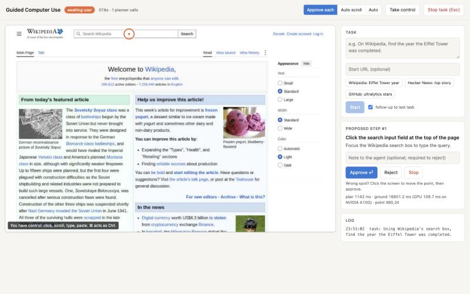
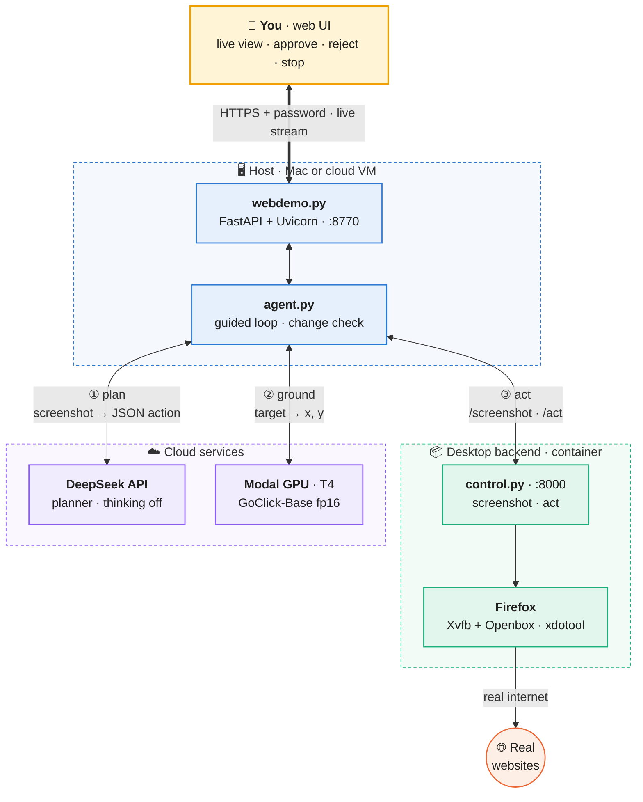
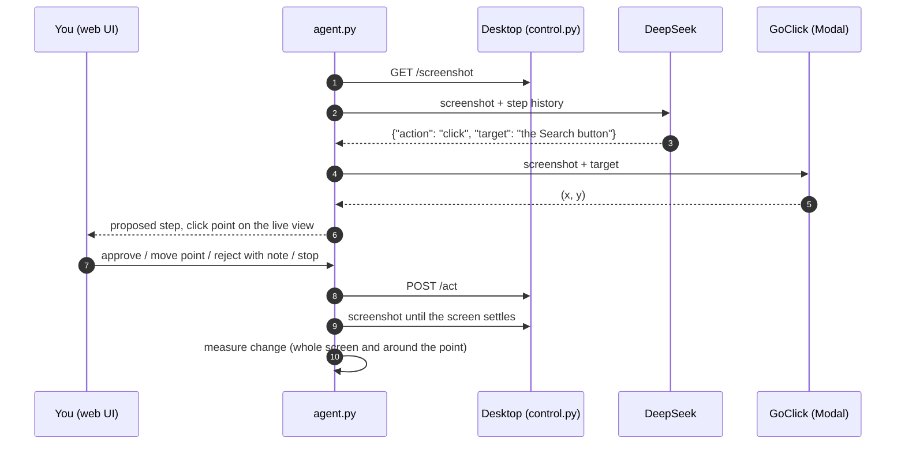
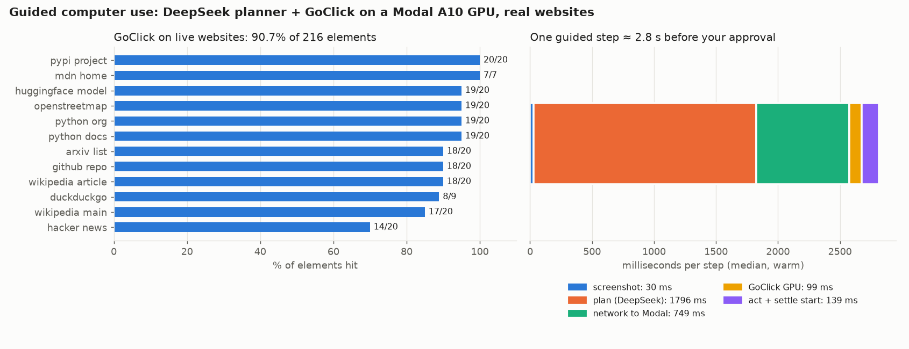
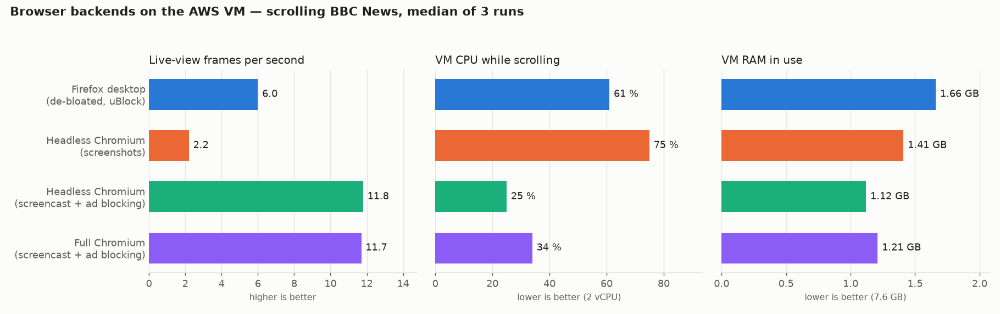
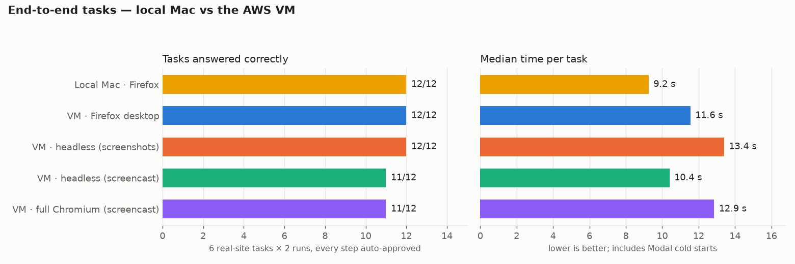

<div align="center">

# Guided Computer Use

**A human-approved browser agent: a DeepSeek planner decides the next step, the GoClick grounder
finds where to click, and you approve every action on a live view of a real browser.**

[](LICENSE)


</div>



---

## Contents

- [Overview](#overview)
- [How the project evolved](#how-the-project-evolved)
- [Architecture](#architecture)
- [Tech stack](#tech-stack)
- [Repository layout](#repository-layout)
- [Getting started](#getting-started)
- [Running](#running)
- [Deploying to a cloud VM](#deploying-to-a-cloud-vm)
- [Results](#results)
- [Security notes](#security-notes)
- [Documentation](#documentation)
- [License](#license)
- [Author](#author)

---

## Overview

The agent works on real websites in a real browser running inside a container. Each step goes
through the same loop:

1. **See.** Take a screenshot of the browser.
2. **Plan.** DeepSeek reads the screenshot and the step history and returns one JSON action:
   `click`, `type`, `key`, `scroll`, `navigate`, `wait`, `ask_user` or `done`.
3. **Ground.** For a click or typing action, GoClick (a 0.2 B Florence-2 model) running on a Modal
   GPU turns the target description, such as "the 'Log in' link", into a pixel position.
4. **Approve.** The web UI shows the action and its click point on the live screen. You can
   approve it, move the point, reject it with a note the planner will read, answer its questions,
   or stop.
5. **Act and check.** The action runs, the agent waits for the screen to settle, then measures what
   changed. "No visible change" goes back into the history so the planner tries something else.

The agent is **guided, not autonomous**: nothing runs without your approval. Passwords and payment
details are always handed back to you.

## How the project evolved

The project started in 2025 as **YOLOv8 UI detection plus a vision-language model** reading a
set-of-mark screenshot (tag `v1-yolo-vlm`; its original README is kept in
[`docs/legacy/README_v1.md`](docs/legacy/README_v1.md)).

Fixing a bug where the VLM was sent the raw frame instead of the annotated one (experiment 01) and
moving detection to a serverless GPU (02) showed where that design ran out of room. Experiment 03
replaced detection with a **planner + grounder** split, DeepSeek deciding what to do and GoClick
deciding where, and proved it on a mock page. The guided agent in [`guided_agent/`](guided_agent/)
took that pattern to real websites, with GoClick on a Modal GPU and a human approving every step.

Experiment 04 then ran the same agent on a small **AWS VM** and made its live view usable from
another continent: streaming, a lighter Firefox, and headless and full Chromium backends. Each step
is recorded in [`experiments/`](experiments/README.md), and the design decisions are in
[`docs/adr/`](docs/adr/).

## Architecture





The desktop backend is replaceable: anything that serves the same `/health`, `/screenshot` and
`/act` API works. Three are included. The **Firefox desktop** container is the default. Two
**Chromium** backends (headless, and a full window on a virtual screen) use Playwright and push
frames with Chromium's screencast. The agent picks one with `DESKTOP_URL`. More detail:
[`guided_agent/ARCHITECTURE.md`](guided_agent/ARCHITECTURE.md).

## Tech stack

**Agent and models**


**Serving and web UI**


**Browsers and desktop**


**Containers and infrastructure**


| Layer | Component | Version | Where it is set |
|---|---|---|---|
| Planner | DeepSeek `deepseek-flash`, thinking off, temperature 0 | API | `guided_agent/agent.py` |
| Grounder | GoClick-Base (Florence-2, 0.2 B), fp16 | — | `guided_agent/grounder_modal.py` |
| Grounder runtime | PyTorch / torchvision / Transformers / timm, Python 3.12 on Debian slim | 2.5.1 / 0.20.1 / 4.45.0 / 1.0.15 | `guided_agent/grounder_modal.py` |
| GPU serving | Modal, T4 first, L4 as fallback, 120 s idle shutdown | 1.6.3 | `guided_agent/grounder_modal.py` |
| Host app | FastAPI, Uvicorn, HTTPX, OpenAI SDK, Pillow, NumPy | see file | `guided_agent/requirements.txt` |
| Desktop | Alpine 3.22, Xvfb, Openbox, Firefox 142, xdotool | 3.22 / 142.0 | `guided_agent/desktop/Dockerfile` |
| Chromium backends | Playwright with its Chromium build | 1.64.1 / 156.0 | `experiments/04_cloud_deployment/deploy/` |
| Cloud VM | AWS EC2 `m7i-flex.large`, Ubuntu 24.04, Docker, Caddy | 29.1 / 2.6.2 | `experiments/04_cloud_deployment/REPORT.md` |

## Repository layout

```
.
├── guided_agent/                 # the current system
│   ├── agent.py                  # guided loop, planner prompt, change detection
│   ├── webdemo.py, webdemo.html  # web UI on 127.0.0.1:8770
│   ├── grounder_modal.py         # GoClick on a Modal GPU
│   ├── grounder_client.py        # kept-alive client for the grounder
│   ├── ipv4_only.py, modal_cli.py# IPv4-only workaround for Modal on some networks
│   ├── desktop/                  # Firefox desktop container (Dockerfile, control.py, policies.json)
│   ├── bench_grounding.py        # grounding benchmark against DOM ground truth
│   ├── run_tasks.py              # end-to-end real-site tasks with known answers
│   ├── render_scorecard.py       # benchmark/scorecard.png
│   ├── requirements.txt
│   ├── ARCHITECTURE.md, REPORT.md
│   └── benchmark/, results/
├── experiments/                  # how the project got here, 01–04, each with its report
│   └── 04_cloud_deployment/      # AWS VM: deploy files, Chromium backends, charts, report
├── docs/
│   ├── adr/                      # architecture decision records
│   └── legacy/README_v1.md       # README of the YOLOv8 + VLM version
├── models/, notebooks/, tests/, resources/, rico_break/   # v1 (YOLOv8 + VLM) code and data
├── CHANGELOG.md
└── LICENSE
```

## Getting started

### Prerequisites

| Need | Why |
|---|---|
| macOS with [Apple `container`](https://github.com/apple/container), or any machine with Docker | runs the browser desktop |
| Python 3.12 | host app and benchmarks |
| A [Modal](https://modal.com) account | GPU for the GoClick grounder |
| A [DeepSeek](https://platform.deepseek.com) API key | the planner |

### 1. Install

```bash
git clone https://github.com/tarunk42/AI-Computer-use-using-VLM-and-YOLO.git
cd AI-Computer-use-using-VLM-and-YOLO
git checkout goclick-agent
cd guided_agent
python3.12 -m venv .venv
.venv/bin/pip install -r requirements.txt
.venv/bin/playwright install chromium     # only for bench_grounding.py and the Chromium backends
```

### 2. Deploy the grounder to Modal

```bash
.venv/bin/modal setup                                                  # log in once
python3 -c "import secrets; print(secrets.token_urlsafe(32))" > .grounder_token
chmod 600 .grounder_token                                              # git-ignored
.venv/bin/modal secret create guided-cua-auth GROUNDER_TOKEN="$(cat .grounder_token)"
.venv/bin/python modal_cli.py deploy grounder_modal.py
```

The deploy prints the endpoint URL. Set it for the agent:

```bash
export GROUNDER_URL=https://<workspace>--guided-cua-goclick-grounder-ground.us-east.modal.run
```

`modal_cli.py` is the normal `modal` CLI with IPv4 forced. It is needed only on networks with
broken IPv6; plain `modal deploy grounder_modal.py` works elsewhere.

### 3. Build the desktop

With Apple `container` (macOS):

```bash
container build --tag guided-desktop:2 --file desktop/Dockerfile desktop
container run -d --name guided-desktop -c 2 -m 3G guided-desktop:2
```

The agent finds the container's address by itself.

With Docker:

```bash
docker build -t guided-desktop desktop
docker run -d --name guided-desktop --restart unless-stopped --shm-size 1g \
  -p 127.0.0.1:8000:8000 guided-desktop
export DESKTOP_URL=http://127.0.0.1:8000
```

## Running

```bash
export DEEPSEEK_API_KEY=...          # keep it in your shell; never write it to a file
.venv/bin/python webdemo.py          # open http://127.0.0.1:8770
```

Type a task, for example *"Open the 'show' section of Hacker News and tell me the title of its
first post"*, then approve, adjust or reject each proposed step.

**Configuration**

| Variable | Default | Meaning |
|---|---|---|
| `DEEPSEEK_API_KEY` | required | planner key |
| `GROUNDER_URL` | the author's Modal endpoint | your deployed grounder |
| `DESKTOP_URL` | Apple container's address | desktop backend: `:8000` Firefox, `:8001` headless Chromium, `:8002` full Chromium |

**Benchmarks**

```bash
.venv/bin/python bench_grounding.py 20     # GoClick vs DOM ground truth, 20 targets per site
.venv/bin/python run_tasks.py 2            # 6 real-site tasks × 2 runs (web UI must be running)
.venv/bin/python render_scorecard.py       # writes benchmark/scorecard.png
```

## Deploying to a cloud VM

This is the setup measured in experiment 04. Everything is copied over SSH; nothing goes through a
remote repository. Files are in
[`experiments/04_cloud_deployment/deploy/`](experiments/04_cloud_deployment/deploy/).

**1. Create the VM.** Ubuntu 24.04, 2 vCPU / 8 GB (for example EC2 `m7i-flex.large`), 20 GB disk.
Open only port 22 (SSH) and 443 (HTTPS) in its firewall or security group.

**2. Install the basics on the VM.**

```bash
sudo apt update && sudo apt install -y docker.io python3-venv caddy
sudo usermod -aG docker ubuntu                                     # log out and back in
sudo fallocate -l 2G /swapfile && sudo chmod 600 /swapfile && sudo mkswap /swapfile && sudo swapon /swapfile
```

**3. Copy the code from your machine.**

```bash
git archive goclick-agent guided_agent | ssh -i <key.pem> ubuntu@<vm-ip> "tar -x"
scp -i <key.pem> guided_agent/.grounder_token ubuntu@<vm-ip>:guided_agent/
ssh -i <key.pem> ubuntu@<vm-ip> "chmod 600 guided_agent/.grounder_token"
```

Then copy the VM versions of `webdemo.py`, `webdemo.html` and the `desktop/` files from
`experiments/04_cloud_deployment/deploy/` over the ones in `guided_agent/`. They add streaming,
WebP frames and the lighter Firefox.

**4. Set up and start on the VM.**

```bash
cd ~/guided_agent
python3 -m venv .venv && .venv/bin/pip install -r requirements.txt
docker build -t guided-desktop desktop
docker run -d --name guided-desktop --restart unless-stopped --shm-size 1g \
  -p 127.0.0.1:8000:8000 guided-desktop
```

**5. Start the web UI** from your machine with `deploy/start_webui.sh`. It sends the DeepSeek key
from your shell over SSH into the program's memory, so the key is never written on the VM:

```bash
VM=ubuntu@<vm-ip> KEY=<key.pem> zsh experiments/04_cloud_deployment/deploy/start_webui.sh
```

**6. Public HTTPS with a password.** Fill in [`deploy/Caddyfile`](experiments/04_cloud_deployment/deploy/Caddyfile)
with your host name (a `<ip-with-dashes>.sslip.io` name works without owning a domain) and a bcrypt
hash from `caddy hash-password`, copy it to `/etc/caddy/Caddyfile`, and run
`sudo systemctl restart caddy`. Caddy gets a Let's Encrypt certificate by itself.

Without a public address, an SSH tunnel works too:
`ssh -i <key.pem> -L 8770:127.0.0.1:8770 ubuntu@<vm-ip>`, then open `http://127.0.0.1:8770`.

**Optional Chromium backends.** `deploy/headless/control.py` (port 8001) and
`deploy/chromium/control.py` with `deploy/chromium/start.sh` (port 8002) need
`.venv/bin/playwright install --with-deps chromium`. Start the web UI with port `8001` or `8002` as
the script's argument to use one.

> A stopped and restarted EC2 instance gets a new public IP unless it has an Elastic IP. After a
> restart, update the host name in the Caddyfile and restart the web UI and any Chromium backend.

## Results

Full numbers, method and caveats are in the two reports:
[`guided_agent/REPORT.md`](guided_agent/REPORT.md) (local) and
[`experiments/04_cloud_deployment/REPORT.md`](experiments/04_cloud_deployment/REPORT.md) (cloud VM).

### Guided agent, local Mac

| Measure | Result |
|---|---|
| GoClick on live websites (DOM ground truth, 12 sites) | **196/216 elements hit (90.7 %)**, 92.1 % within 10 px |
| Real-site tasks with known answers | **12/12** (6 tasks × 2), median 11.2 s, mean 3.0 steps |
| One guided step before approval (median) | **~2.8 s**: 1.8 s DeepSeek, 0.75 s network to Modal, 0.1 s GPU |
| Planner cost | **$0.0148** for 12 tasks (~$0.0012 per task) |



### Local Mac vs AWS VM, by browser backend

| Setup | Tasks correct | Median time per task | Live view | VM CPU | VM RAM |
|---|---|---|---|---|---|
| Local Mac, Firefox | 12/12 | 9.2 s | — | — | — |
| VM, Firefox desktop (lighter, uBlock) | 12/12 | 11.6 s | 6.0 fps | 61 % | 1.66 GB |
| VM, headless Chromium, screenshots | 12/12 | 13.4 s | 2.2 fps | 75 % | 1.41 GB |
| VM, headless Chromium, screencast | 11/12 | 10.4 s | 11.8 fps | 25 % | 1.12 GB |
| VM, full Chromium, screencast | 11/12 | 12.9 s | 11.7 fps | 34 % | 1.21 GB |

Task times include Modal cold starts. Both misses were Hacker News rate-limiting the VM's address.
The live view was measured scrolling BBC News, median of 3 runs. GoClick from the VM hit
182/198 elements (91.9 %).





**What the comparison shows**

- The agent gives the same answers on the VM as on the Mac. The extra time comes from the network
  path to the Modal GPU.
- Chromium's screencast doubles the live-view frame rate of the Firefox desktop at about half the
  CPU.
- Some sites treat a cloud address differently. Hacker News rate-limited it, and US News served
  headless Chromium an empty page but loaded in Firefox and full Chromium. Sites that check for
  automated browsers, including Google sign-in, refuse the Playwright-driven Chromium backends.
  They accept the Firefox desktop, which receives ordinary mouse and keyboard input.

## Security notes

- The DeepSeek key is read from the environment and never written to disk, locally or on the VM.
- The grounder token lives in `guided_agent/.grounder_token` (mode 600, git-ignored) and in the
  Modal secret `guided-cua-auth`. The endpoint rejects requests without it.
- The web UI binds to `127.0.0.1` only. On a VM it is reached through Caddy with HTTPS and a
  password, or through an SSH tunnel.
- Anyone with the web UI password controls the browser and any accounts signed in to it. Share it
  only with people you trust, and approve steps on account pages with care.

## Documentation

| Document | Contents |
|---|---|
| [`guided_agent/ARCHITECTURE.md`](guided_agent/ARCHITECTURE.md) | diagram and file map |
| [`guided_agent/REPORT.md`](guided_agent/REPORT.md) | the guided agent's technical report |
| [`experiments/README.md`](experiments/README.md) | experiments 01–04 and their reports |
| [`experiments/04_cloud_deployment/REPORT.md`](experiments/04_cloud_deployment/REPORT.md) | latest report: cloud VM, live view, browser backends |
| [`docs/adr/`](docs/adr/) | why planner + grounder, why Modal, why guided |
| [`docs/legacy/README_v1.md`](docs/legacy/README_v1.md) | the YOLOv8 + VLM version |
| [`CHANGELOG.md`](CHANGELOG.md) | release notes |

## License

Released under the [MIT License](LICENSE). GoClick, DeepSeek and the other third-party models and
services keep their own licences and terms.

## Author

**tarun kashyap** · [tarunsinghkashyap@gmail.com](mailto:tarunsinghkashyap@gmail.com)
