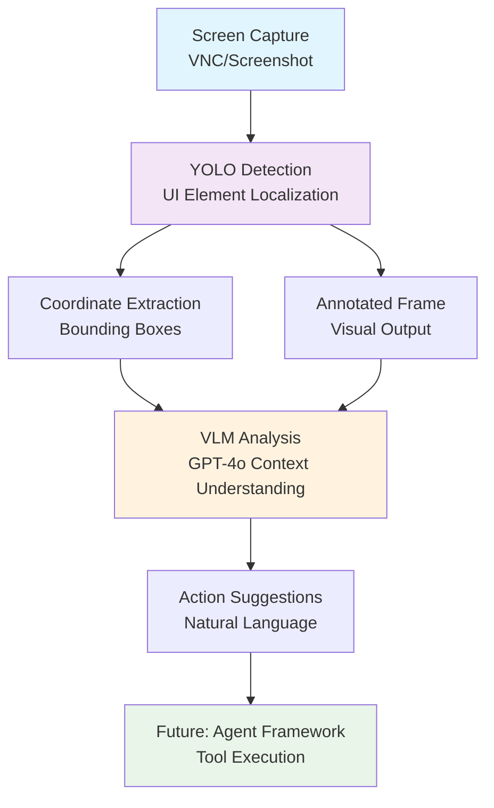
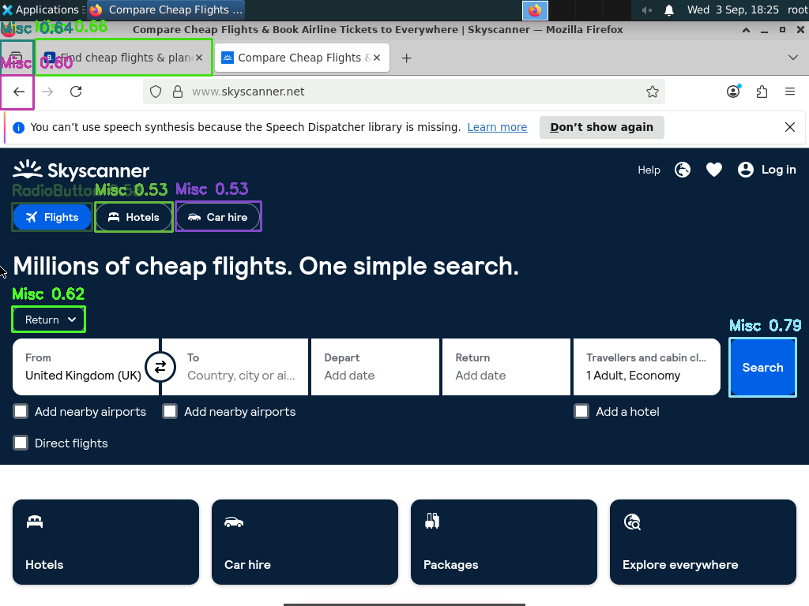

# 🎯 AI Computer Use - UI Detection & Automation Platform

> A foundational system for AI-driven computer interaction using YOLOv8 object detection and Vision-Language Models (VLMs) to understand and interact with screen elements.


> **Archived.** This is the README of the first version (YOLOv8 + VLM, tag `v1-yolo-vlm`), kept as
> it was. The current project is described in the [main README](../../README.md).

---

## 📋 Table of Contents

- [🎯 Overview](#-overview)
- [🚀 Project Goals](#-project-goals)
- [🏗️ Architecture](#️-architecture)
- [🛠️ Tech Stack](#️-tech-stack)
- [📁 Project Structure](#-project-structure)
- [🔬 Approaches Tested](#-approaches-tested)
- [🎨 Features](#-features)
- [⚡ Quick Start](#-quick-start)
- [📊 Results & Achievements](#-results--achievements)
- [🔧 Configuration](#-configuration)
- [📈 Performance](#-performance)
- [🛣️ Roadmap](#️-roadmap)
- [🤝 Contributing](#-contributing)
- [👤 Author](#-author)

---

## 🎯 Overview

This project is the **first phase** of building an AI computer use system that can autonomously interact with user interfaces. The system captures screen content, detects UI elements using fine-tuned YOLO models, and leverages Vision-Language Models (VLMs) to understand context and suggest actions.

**The Vision**: Enable AI agents to "see" and "act" on screens like humans do - identifying buttons, forms, links, and other UI components to perform complex automation tasks.

---

## 🚀 Project Goals

### Primary Objectives
- **🔍 UI Element Detection**: Accurately identify and localize UI components (buttons, fields, links, etc.)
- **📍 Coordinate Extraction**: Provide precise bounding boxes for clickable/interactable elements
- **🧠 Contextual Understanding**: Use VLMs to interpret UI functionality and suggest user actions
- **⚡ Real-time Processing**: Achieve low-latency detection suitable for live automation
- **🔗 VLM Integration**: Bridge visual detection with language understanding for intelligent action planning

### Long-term Vision
- **🤖 Agent Framework**: Build tool-calling agents that can execute actions based on screen analysis
- **🔄 Feedback Loop**: Implement closed-loop automation with success/failure detection
- **🌐 Multi-platform Support**: Extend beyond web UIs to desktop and mobile applications

---

## 🏗️ Architecture



---

## 🛠️ Tech Stack

### Core Technologies
| Technology | Purpose | Version |
|------------|---------|---------|
|  | Primary Language | 3.13 |
|  | Object Detection | Ultralytics 8.3+ |
|  | Vision-Language Model | GPT-4o |
|  | Computer Vision | 4.11+ |
|  | Deep Learning Backend | 2.6+ |

### Supporting Libraries
- **VNC Control**: `vncdotool` for remote screen capture
- **Image Processing**: `PIL`, `matplotlib` for visualization
- **Data Handling**: `numpy`, `pathlib` for efficient processing
- **API Integration**: `openai` for GPT-4o communication

---

## 📁 Project Structure

```
📦 annotate/
├── 📁 agents/                 # Future: Tool-calling agents
├── 📁 annenv/                 # Python virtual environment
├── 📁 models/                 # Trained YOLO models & configs
│   ├── 🎯 yolov8_ui_model.pt  # Web UI detection model
│   ├── 🎯 chunk01_best.pt     # RICO mobile UI model
│   ├── 🎯 chunk02_best.pt     # RICO mobile UI model (v2)
│   └── 📄 *.yaml             # Dataset configurations
├── 📁 notebooks/              # Jupyter training & testing
│   └── 📘 train.ipynb         # Model training & evaluation
├── 📁 resources/              # Images & outputs
│   ├── 📁 input/              # Test images
│   ├── 📁 output/             # Annotated results
│   └── 📁 temp/               # Temporary files
├── 📁 tests/                  # Testing scripts
│   ├── 🔄 vnc_vlm_loop.py     # Main: VNC+YOLO+VLM pipeline
│   ├── 📹 screen_grab.py      # Real-time detection demo
│   ├── 🖼️ single_frame.py     # Single frame analysis
│   └── 🧠 test_models.py      # VLM testing
└── 📁 rico_break/             # Dataset preparation tools
```

---

## 🔬 Approaches Tested

### Approach 1: RICO Dataset (Mobile UI Focus)
- **Dataset**: [RICO](http://interactionmining.org/rico) - 66k+ mobile app screenshots
- **Classes**: Button, CheckBox, EditText, ImageButton, RadioButton, ToggleButton, Spinner, Switch, SeekBar, Misc
- **Models**: `chunk01_best.pt`, `chunk02_best.pt`
- **Performance**: ~120ms inference, good for mobile interfaces

### Approach 2: Web UI Dataset (Roboflow)
- **Dataset**: [Website Screenshots](https://universe.roboflow.com/roboflow-gw7yv/website-screenshots/dataset/1)
- **Classes**: button, field, heading, iframe, image, label, link, text
- **Models**: `yolov8_ui_model.pt`, `yolov8_ui_100.pt`
- **Performance**: ~125ms inference, optimized for web interfaces

### Key Findings
- ✅ **Low Latency**: Both approaches achieve real-time performance (~120-130ms)
- ⚠️ **Accuracy Challenges**: Generic UI detection remains challenging due to diverse layouts
- ✅ **Viable Foundation**: Despite accuracy limitations, provides sufficient localization for VLM integration
- 🎯 **VLM Enhancement**: GPT-4o significantly improves context understanding and action planning

---

## 🎨 Features

### 🔍 Real-time UI Detection
- Live VNC screen capture every 2-20 seconds
- YOLOv8-based object detection with confidence filtering
- Colored bounding box visualization with labels

### 🧠 AI-Powered Analysis
- GPT-4o integration for contextual UI understanding
- Automatic correlation between detected elements and their functions
- Natural language action suggestions

### 📊 Comprehensive Output
- **Visual**: Annotated screenshots with detection boxes
- **Textual**: Detailed descriptions and action recommendations
- **Structured**: Confidence scores and coordinate data

### ⚡ Performance Optimized
- Efficient inference pipeline (~120ms per frame)
- Configurable confidence thresholds
- Background processing for continuous monitoring

---

## ⚡ Quick Start

### Prerequisites
```bash
# Python 3.13+ required
python --version

# Clone repository
git clone https://github.com/tarunk42/AI-Computer-use-using-VLM-and-YOLO.git
cd annotate
```

### Environment Setup
```bash
# Create virtual environment
python -m venv venv

# Activate virtual environment
source venv/bin/activate  # On Windows: venv\Scripts\activate

# Install dependencies
pip install -r requirements.txt
```

### Configuration
```bash
# Set OpenAI API key
echo "OPENAI_API_KEY=your_key_here" > .env

# Configure VNC settings in test files
VNC_HOST = "localhost"
VNC_PORT = 5900
VNC_PASSWORD = "1234"
```

### Run Examples

#### 1. Single Frame Analysis
```bash
python tests/single_frame.py
```

#### 2. Real-time Detection Demo
```bash
python tests/screen_grab.py
```

#### 3. Full VLM Pipeline (Recommended)
```bash
python tests/vnc_vlm_loop.py
```

#### 4. Batch Processing
```bash
# Place images in resources/input/
jupyter notebook notebooks/train.ipynb
# Run cells 6-7 for batch processing
```

---

## 📊 Results & Achievements

### ✅ Successfully Implemented
- **Multi-Model Training**: 2 different approaches with distinct datasets
- **Real-time Pipeline**: VNC capture → YOLO detection → VLM analysis
- **VLM Integration**: GPT-4o providing contextual understanding
- **Coordinate Extraction**: Precise bounding boxes for automation
- **Visualization**: Professional annotation system with confidence scores

### 📈 Performance Metrics
| Metric | Value | Notes |
|--------|--------|-------|
| **Inference Speed** | ~120ms | Per frame, includes pre/post-processing |
| **Detection Classes** | 8-10 | Covering major UI element types |
| **Confidence Threshold** | 0.4-0.6 | Adjustable based on use case |
| **VLM Response Time** | ~10-30s | GPT-4o analysis per frame |
| **Resolution** | 480x640 | VNC capture resolution |

### 🎯 Sample Output
```
Detections: Button (conf: 0.79), RadioButton (conf: 0.58), Misc (conf: 0.66)

VLM Analysis:
The blue bounding box (#1) identifies a Search button that initiates flight searches.
The green bounding box (#2) marks a RadioButton for "Direct flights only" option.
Suggested action sequence: Fill departure/destination → Select dates → Click Search.
```

---

## 🔧 Configuration

### Model Selection
```python
# Web UI optimized
MODEL_PATH = "./models/yolov8_ui_model.pt"

# Mobile UI optimized  
MODEL_PATH = "./models/chunk02_best.pt"
```

### Detection Parameters
```python
CONF_THRESHOLD = 0.5    # Confidence threshold
INTERVAL = 20           # Seconds between captures
ALLOWED_CLASSES = {"button", "field", "link"}  # Filter classes
```

### VLM Settings
```python
model="gpt-4o"         # or "gpt-4o-mini" for faster/cheaper
max_tokens=800         # Response length limit
```

---

## 📈 Performance

### Latency Breakdown
- **VNC Capture**: ~50ms
- **YOLO Inference**: ~120ms
- **Post-processing**: ~5ms
- **VLM Analysis**: ~15-30s (when enabled)

### Accuracy Considerations
- **Strength**: Excellent for common UI patterns (buttons, forms)
- **Challenge**: Complex layouts and custom UI elements
- **Mitigation**: VLM provides context even for missed detections

---

## 🛣️ Roadmap

### Phase 2: Agent Framework
- [ ] Tool-calling implementation
- [ ] Action execution (clicks, form filling)
- [ ] Success/failure detection

### Phase 3: Enhanced Intelligence
- [ ] Multi-modal reasoning
- [ ] Dynamic confidence adjustment
- [ ] Learning from interaction patterns

### Phase 4: Production Ready
- [ ] Multi-platform support (Windows, macOS, Linux)
- [ ] API service architecture
- [ ] Performance optimization
- [ ] Security hardening

---

## 🤝 Contributing

This is a research project demonstrating the foundational components for AI computer use. Key areas for improvement:

1. **Model Accuracy**: Better training data and augmentation techniques
2. **Speed Optimization**: Model quantization and inference acceleration
3. **Agent Integration**: Implementing actual automation capabilities
4. **Dataset Expansion**: More diverse UI patterns and contexts

---

## 🎯 Sample Outputs

Below are real examples of the system's output from running `vnc_vlm_loop.py` on a flight booking website. Each frame shows YOLO detections (colored bounding boxes) overlaid on the captured screen, followed by GPT-4o analysis.

### Frame 001: Flight Search Interface


**Detections:** Misc (conf: 0.79), Misc (conf: 0.66), Misc (conf: 0.64), Misc (conf: 0.62), Misc (conf: 0.60), RadioButton (conf: 0.58), Misc (conf: 0.53), Misc (conf: 0.53)

**VLM Analysis:**
Based on the image provided, here is an analysis of the UI elements and potential user interactions:

1. **Colored Bounding Box Analysis:**

   - **Bounding Box 6 (RadioButton, conf: 0.58):**
     - **Element:** RadioButton options for "Add nearby airports" and "Direct flights."
     - **Function:** Allow users to refine their search by including nearby airports and opting for direct flights only.
     - **User Actions:** Users can check/uncheck options to include nearby airports or restrict results to direct flights.

   - **Likely Bounding Boxes for other UI elements:**

     - **Top Navigation Tabs ("Flights," "Hotels," "Car hire"):**
       - **Function:** Switch between different search modes (flights, hotels, car rentals).
       - **User Actions:** Click to select the type of search they want to perform.
   
     - **Input Fields: ("From," "To," "Depart," "Return," "Travelers and cabin class"):**
       - **Function:** Enter search details such as departure/arrival locations, dates, and cabin preferences.
       - **User Actions:** Enter or select information to specify search parameters.

     - **Search Button:**
       - **Function:** Execute the search based on the entered parameters.
       - **User Actions:** Click to initiate the search process.

2. **User Actions and Logical Sequence:**

   - **Select Mode of Transport:**
     - Click on the relevant tab ("Flights," "Hotels," "Car hire") to choose the search type.

   - **Enter Search Details:**
     - Fill in the "From" and "To" locations.
     - Select departure and return dates.
     - Specify the number of travelers and cabin class.

   - **Refine Search:**
     - Use checkboxes (RadioButtons) to include/exclude nearby airports and direct flights if searching for flights.

   - **Initiate Search:**
     - Click the "Search" button to find and display results based on the criteria.

This sequence ensures users specify their travel details before executing a comprehensive search.

### Frame 004: Travel Booking Form


**Detections:** Misc (conf: 0.77), Misc (conf: 0.75), Misc (conf: 0.75), Misc (conf: 0.70), Misc (conf: 0.66), Misc (conf: 0.58), Misc (conf: 0.54)

**VLM Analysis:**
Based on the image, I can provide an analysis of the UI elements within the colored bounding boxes:

1. **UI Element Identification and Function:**

   - **Bounding Box 1 (Top Row Options, e.g., Round-trip, One-way):** 
     - **Element Type:** Radio Buttons
     - **Function:** Allows the user to select the type of trip, such as Round-trip, One-way, or Multi-city.

   - **Bounding Box 2 (Economy/Flight Class Dropdown):**
     - **Element Type:** Dropdown Menu
     - **Function:** Allows the user to select the flight class, such as Economy, Business, or First Class.

   - **Bounding Box 3 (Leaving From Input):**
     - **Element Type:** Input Field
     - **Function:** Allows the user to specify the departure airport or location.

   - **Bounding Box 4 (Going To Input):**
     - **Element Type:** Input Field
     - **Function:** Allows the user to specify the destination airport or location.

   - **Bounding Box 5 (Travel Dates Selection):**
     - **Element Type:** Date Picker
     - **Function:** Allows the user to select the travel start and end dates.

   - **Bounding Box 6 (Travelers Selection):**
     - **Element Type:** Dropdown/Spinner
     - **Function:** Allows the user to select the number of travelers, including adults and children.

   - **Bounding Box 7 (Explore Button):**
     - **Element Type:** Button
     - **Function:** Initiates the search for flights based on the specified criteria.

2. **Actions a User Could Take:**

   - **Radio Buttons:** Select the trip type according to travel plans.
   - **Economy Dropdown:** Choose the preferred class for travel.
   - **Leaving From Input:** Enter or select the starting location.
   - **Going To Input:** Enter or select the destination.
   - **Travel Dates Picker:** Set the desired travel dates.
   - **Travelers Spinner:** Specify the number of people traveling.
   - **Explore Button:** Click to execute the search for available flights.

3. **Logical Sequence of Actions:**

   - Choose the trip type (Round-trip, One-way, Multi-city).
   - Select the flight class (e.g., Economy).
   - Enter departure and destination locations.

### Frame 005: Flight Search Interface


**Detections:** Misc (conf: 0.77), Misc (conf: 0.75), Misc (conf: 0.75), Misc (conf: 0.70), Misc (conf: 0.66), Misc (conf: 0.58), Misc (conf: 0.54)

**VLM Analysis:**
Based on the image provided, here's an analysis of the UI elements and their functions:

1. **UI Element Identification:**
   - **Box #1: Travel Type Selection**
     - Function: Allows users to choose between round-trip, one-way, multi-city, and economy options.
     - Actions: Users select the type of flight they wish to book.
   
   - **Box #2: Departure Location Field ("Leaving from")**
     - Function: Input field for users to specify their departure airport.
     - Actions: Users enter or select their departure airport, e.g., "London All airports."
   
   - **Box #3: Arrival Location Field ("Going to")**
     - Function: Input field for users to specify their destination airport.
     - Actions: Users enter or select their destination.
   
   - **Box #4: Travel Dates Field**
     - Function: Date picker for users to select their travel dates.
     - Actions: Users choose departure and return dates for their trip.
   
   - **Box #5: Number of Travelers Field**
     - Function: Dropdown to specify the number of travelers.
     - Actions: Users select the number of adults, children, and infants traveling.
   
   - **Box #6: Direct Flights Only Checkbox**
     - Function: Option to filter search results to show only direct flights.
     - Actions: Users check or uncheck to include/exclude direct flights.
   
   - **Box #7: Explore Button**
     - Function: Submit button to search for flights based on input criteria.
     - Actions: Users click to initiate the search based on the specified parameters.

2. **Logical Sequence of Actions:**
   - Select the type of trip (e.g., round-trip) in the Travel Type Selection.
   - Input the departure airport in the Departure Location Field.
   - Specify the destination airport in the Arrival Location Field.
   - Choose the desired travel dates in the Travel Dates Field.
   - Indicate the number of travelers in the Number of Travelers Field.
   - Check the Direct Flights Only option if applicable.
   - Click the Explore Button to search for available flights.

This sequence ensures that the user specifies all necessary information to perform a flight search effectively.

---

## � Author

**Tarun Kashyap**

- **GitHub**: [@tarunk42](https://github.com/tarunk42)
- **LinkedIn**: [tarun-kashyap](https://linkedin.com/in/tarun-kashyap)
- **Website**: [tarunk42.github.io](https://tarunk42.github.io)

---

## �📄 License

MIT License

---

## 🙏 Acknowledgments

- **Datasets**: RICO dataset team, Roboflow community
- **Frameworks**: Ultralytics YOLOv8, OpenAI GPT-4o
- **Tools**: vncdotool for VNC integration

---


