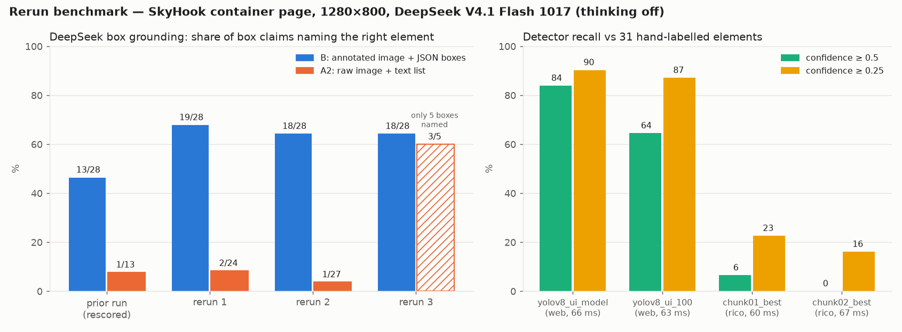

# Rerun of the container UI-detection experiment

**Date:** 2026-10-20 · **Target:** `cua-ui` container (Alpine, Firefox kiosk, 1280×800) at `192.168.64.11:5900`
**VLM:** DeepSeek API, model alias `deepseek-flash` (DeepSeek V4.1 Flash 1017), **thinking disabled on every call**
**Detectors:** the four fine-tuned checkpoints in `models/` at the repo root

The previous run's report (auto-generated by DeepSeek), results and benchmark are kept under
`prior/` for comparison.



---

## What changed from the original experiment

| | |
|---|---|
| API key | read from the `DEEPSEEK_API_KEY` environment variable instead of the repo's `.env` |
| Output folder | `RESULTS_DIR` env var, so the pipeline ran 3 times into `results/run1..3` |
| Detector benchmark | new `bench_detectors.py`: all 4 fine-tuned models, 2 thresholds, 10 timed runs each |
| VLM scoring | re-audited by hand for all 6 A2/B answers (`benchmark/vlm_audit.json`) |
| Chart | new `render_scorecard.py` |
| Not copied | `.venv`, `.uv-cache`, the container's SSH key pair |

Matching rules are unchanged: a box matches a ground-truth element at IoU ≥ 0.40; a box whose centre
falls inside an element otherwise counts as a duplicate. The 31-element ground truth in
`benchmark_data.py` is unchanged.

---

## 1. Detectors

Same frame, confidence ≥ 0.5 unless noted, Apple-silicon CPU, median of 10 warm runs.

| Model | Trained on | Boxes | Recall | Precision¹ | Label acc. | Recall @0.25 | Median |
|---|---|---|---|---|---|---|---|
| `yolov8_ui_model.pt` | web screenshots | 28 | **84 %** | 93 % | 88 % | 90 % | 66 ms |
| `yolov8_ui_100.pt` | web screenshots | 25 | 65 % | 80 % | 90 % | 87 % | 63 ms |
| `chunk01_best.pt` | RICO mobile | 2 | 6 % | 100 % | n/a² | 23 % | 60 ms |
| `chunk02_best.pt` (repo default) | RICO mobile | **0** | **0 %** | — | n/a² | 16 % | 67 ms |

¹ boxes matched to a distinct element ÷ all boxes (the original report's definition).
² RICO models use a different class set, so they are scored on boxes only.

- **`yolov8_ui_model.pt` reproduces the previous run exactly:** same 28 boxes in all 3 captures,
  same 5 misses (Search button, Round-trip radio, Add-hotel checkbox, India card, Japan card).
  At 0.25 it finds the Search button and Round-trip radio too, but adds 14 duplicates and 5 false
  positives.
- **`yolov8_ui_100.pt` is worse at 0.5:** it misses all three checkboxes, two radios, three of the
  four country cards, the Explore heading and the footer. At 0.25 it nearly catches up (87 %).
- **Both mobile models are unusable on a desktop page.** Highest confidence: 0.54 (`chunk01`),
  0.42 (`chunk02`). The repo's main loop still defaults to `chunk02_best.pt`.
- Speed is the same for all four (60–67 ms). Picking a detector is purely an accuracy decision.

## 2. VLM grounding

Strict scoring: a claim counts only if it names the element the box actually covers.

| Variant | Prior run (rescored) | Rerun 1 | Rerun 2 | Rerun 3 | Rerun mean |
|---|---|---|---|---|---|
| **B** annotated image + JSON boxes | 13/28 (46 %) | 19/28 (68 %) | 18/28 (64 %) | 18/28 (64 %) | **65 %** |
| **A2** raw image + text list | 1/13 (8 %) | 2/24 (8 %) | 1/27 (4 %) | 3/5³ | **~6 %** |
| **A1** as published (no boxes) | — | — | — | — | not scorable |

³ Rerun 3's A2 grouped boxes by detector class ("#13, #19, #24 are the fields") and only named 5
boxes individually, so it isn't comparable.

**The previous report's 57 % was overstated.** It marked B's four navigation-tab claims as correct
when each was shifted by one tab. Under the same strict rules, the previous answer scores
**13/28 (46 %)**.

**Findings:**

1. **Sending the annotated image is a ~10× improvement:** 65 % vs about 6 %, and it holds
   across all runs.
2. **Results vary between runs.** B ranged 46–68 % over 4 runs of the identical prompt and image.
   One run is not enough to compare two setups.
3. **The same mistakes recur in every rerun:**
   - **#3** is the Travellers field, but YOLO labelled it `button`, so DeepSeek calls it the
     Search button (3/3 runs).
   - That knocks on to **#18** (the Return field), which DeepSeek then calls Travellers (3/3).
   - **#6** (Packages) and **#17** (Flights): tabs named one tab off (3/3).
   - **#7** (Round-trip label): named as a neighbouring option (3/3).

   The model trusts the detector's label over what is under the box, and confuses neighbouring
   elements in a row. Both point to a grounder (e.g. GoClick) working from plain instructions
   instead of box numbers.
4. **A1 still notices the missing boxes.** All three runs say there are no boxes in the image
   and then describe the page from the pixels.
5. **The 900-token limit cuts off the original prompt.** All three A1 answers and two of three
   A2 answers stopped at 900 tokens (`finish_reason = length`). All B answers finished normally
   (912–1,159 tokens, B had a 2,000 limit).

## 3. Latency and cost

| | Value |
|---|---|
| VNC capture (vncdotool) | 4.47 s first call, then 1.66 s and 1.77 s |
| Detector (`yolov8_ui_model`) | 62–68 ms warm; first call 925 ms (torch warm-up) |
| DeepSeek A1 / A2 / B | 6.2–6.5 s / 5.3–5.5 s / 6.3–6.9 s |
| Generation speed | ~140–170 output tokens/s (5.8–7.2 ms per token, including the wait for the first token) |
| Prompt tokens A1 / A2 / B | 764 / 1,125 / 2,576 |
| Cost of all 9 calls | **$0.014** (at $0.30 / 1M in, $1.20 / 1M out, the prices used in the previous report; not re-checked) |

The VLM call is about 90 % of each cycle's time. Answers are long (800–1,150 tokens), so
asking for a short structured answer is the cheapest speed-up.

## 4. Caveats

- One page and one frame. All three captures were pixel-identical for detection purposes.
- Three VLM samples per variant at default temperature. This is enough to show the spread, not to
  pin down a number.
- Hand-scored by one auditor. The rules and per-box verdicts are in `benchmark/vlm_audit.json`.
- The API reports the model as `deepseek-flash`, an alias. It currently maps to V4.1 Flash 1017,
  but the response doesn't confirm the exact version.

## Reproduce

```bash
uv venv --python 3.12 .venv
uv pip install --python .venv/bin/python ultralytics opencv-python-headless pillow openai vncdotool matplotlib
export DEEPSEEK_API_KEY=...            # never written to disk here
for r in 1 2 3; do mkdir -p results/run$r; RESULTS_DIR=$PWD/results/run$r .venv/bin/python -I run_experiment.py; done
.venv/bin/python -I bench_detectors.py results/run1/frames/frame_raw.png results/detectors.json
.venv/bin/python -I render_scorecard.py
```
