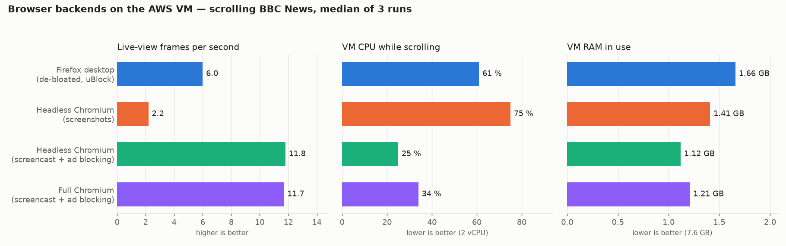
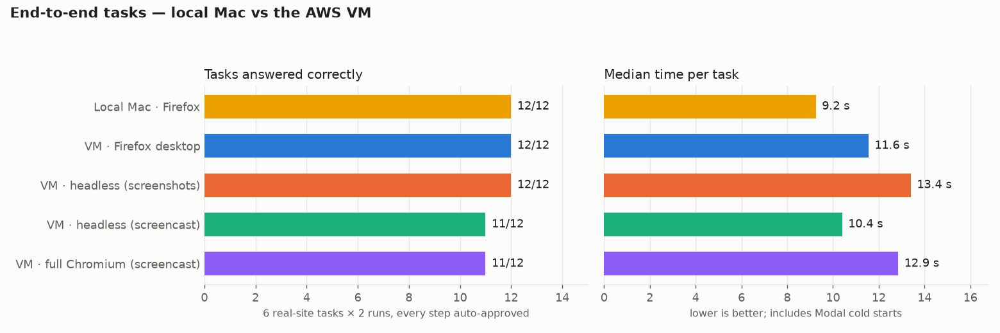
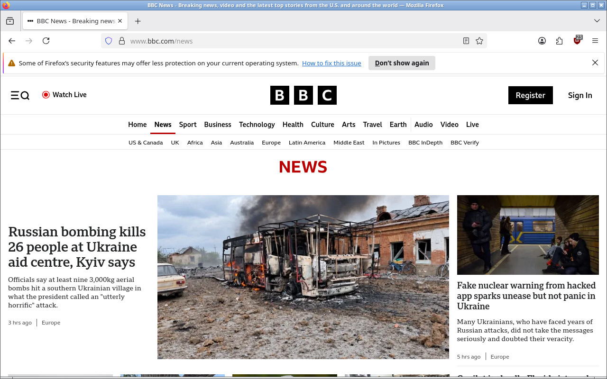
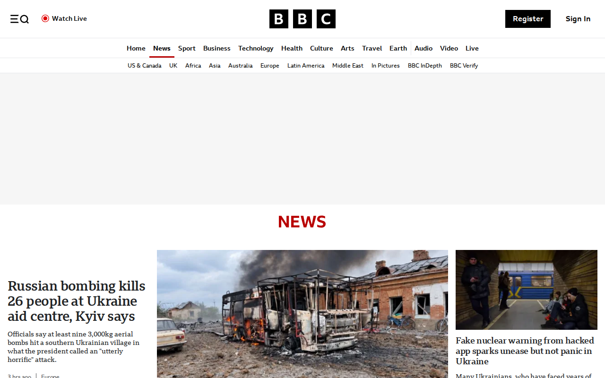
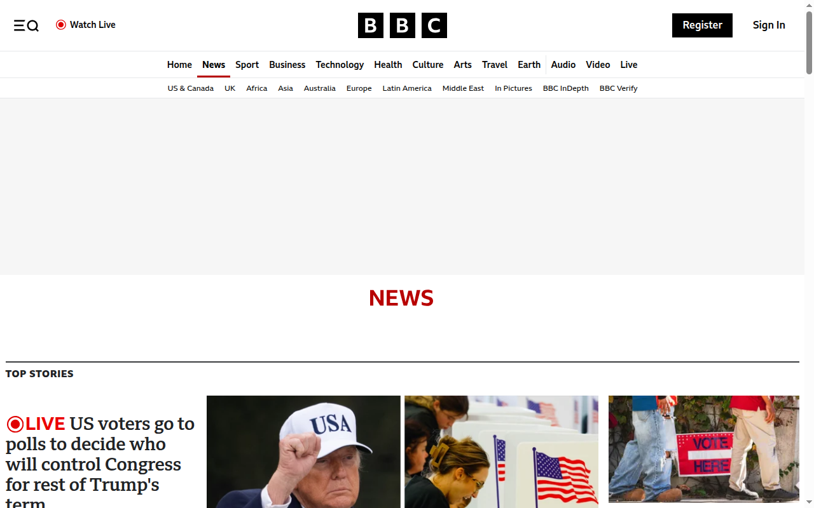
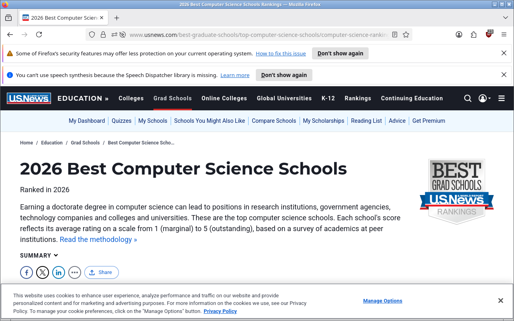
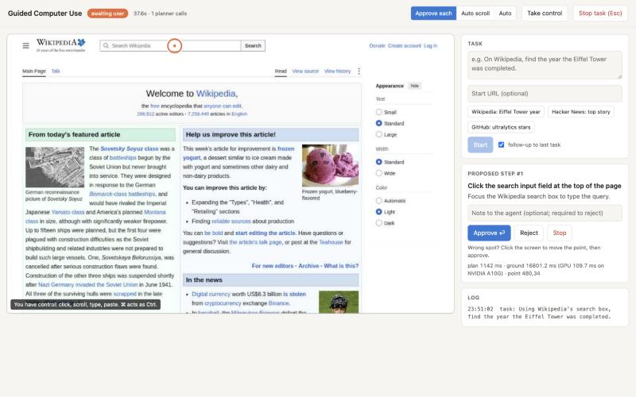

# Experiment 04 — the guided agent on a cloud VM

**Date:** 2026-11-03 (full Chromium backend: 2026-11-04) · **Folder:** `experiments/04_cloud_deployment/`
**VM:** AWS EC2 `m7i-flex.large` (2 vCPU, 7.6 GB usable RAM), Ubuntu 24.04, 20 GB gp3, region
`ap-southeast-2` (Sydney), AWS Free plan credits
**Unchanged from [`guided_agent/`](../../guided_agent/REPORT.md):** DeepSeek planner (thinking off),
GoClick-Base grounder on a Modal T4, the guided loop in `agent.py`
**Question:** does the guided agent work the same on a small cloud VM, and what does it take to
make the live view usable from far away?





---

## Headline

| | Result |
|---|---|
| Real-site tasks on the VM, Firefox desktop | **12/12**, median 11.6 s (local Mac: 12/12, 9.2 s) |
| Same tasks, headless Chromium with screencast | **11/12**, median 10.4 s; the miss was Hacker News rate-limiting the VM's IP |
| GoClick on live websites, run from the VM | **182/198 hit (91.9 %)** (local: 196/216, 90.7 %) |
| Live view while scrolling, Firefox desktop | **6.0 frames/s** at 61 % CPU |
| Live view while scrolling, headless Chromium + screencast | **11.8 frames/s** at 25 % CPU, 1.12 GB RAM |
| Same tasks, full Chromium with screencast | **11/12**, median 12.9 s; the miss was again Hacker News rate-limiting |
| Live view while scrolling, full Chromium + screencast | **11.7 frames/s** at 34 % CPU, 1.21 GB RAM; loads US News, which headless did not |
| Round trip from the operator (India) to the VM (Sydney) | ~365 ms (TCP connect) |

The agent itself behaved the same on the VM. The work in this experiment was in getting the
screen to the operator quickly across ~365 ms of network delay, on 2 vCPUs.

## 1. Setup

```
 operator's browser ──HTTPS + password──► Caddy (443) ──► webdemo.py (127.0.0.1:8770)
   (or an SSH tunnel to 8770)                                │
                                                             ├─► desktop backend (127.0.0.1:8000, :8001 or :8002)
                                                             ├─► DeepSeek API (planner)
                                                             └─► Modal T4 (GoClick)
```

| Part | What runs | Notes |
|---|---|---|
| VM | Docker, Python venv, Playwright Chromium, Caddy | 2 GB swap added; only ports 22 and 443 open |
| Desktop backend A | `guided-desktop` container (Xvfb + Openbox + Firefox), port 8000 | Same Dockerfile as on the Mac; Firefox tuned (§3.4) |
| Desktop backend B | `deploy/headless/control.py`, headless Chromium via Playwright, port 8001 | Same HTTP API (`/health`, `/screenshot`, `/act`); the agent switches with `DESKTOP_URL` |
| Desktop backend C | `deploy/chromium/control.py`, full Chromium on its own Xvfb screen (`:1`), port 8002 | Same API and code as B with a visible browser window (§3.6) |
| Web UI | `webdemo.py` bound to 127.0.0.1 only | Reached through Caddy or an SSH tunnel |
| Public entry | Caddy 2.6 with a Let's Encrypt certificate (sslip.io hostname) and HTTP basic auth | Without the password: HTTP 401; port 8770 is not reachable from outside |
| Secrets | Grounder token file `chmod 600`; DeepSeek key piped over SSH into the process environment | The key is never written on the VM (`deploy/start_webui.sh`) |

The code was copied with `git archive goclick-agent guided_agent | ssh … tar -x`; nothing went
through a remote repository.

## 2. Same benchmarks as on the Mac

### 2.1 End-to-end tasks (`run_tasks.py 2`)

The six tasks and checks from [`guided_agent/REPORT.md`](../../guided_agent/REPORT.md), two runs
each, every proposal approved unchanged.

| Setup | Correct | Median time | Mean steps | Median plan | Median ground round trip |
|---|---|---|---|---|---|
| Local Mac, Firefox (`guided_agent/results/tasks_v4_t4.json`) | 12/12 | 9.2 s | 2.6 | 1455 ms | 775 ms |
| VM, Firefox desktop | 12/12 | 11.6 s | 2.7 | 1490 ms | 1216 ms |
| VM, headless Chromium (screenshots) | 12/12 | 13.4 s | 4.0 | 1364 ms | 989 ms |
| VM, headless Chromium (screencast) | 11/12 | 10.4 s | 4.6 | 1203 ms | 980 ms |
| VM, full Chromium (screencast) | 11/12 | 12.9 s | 4.8 | 1256 ms | 1076 ms |

- Grounding takes longer from Sydney than from the Mac: the Modal T4 is in `us-east`.
- The first task of a run includes a Modal cold start: 35.6 s on Firefox, 125 s on headless
  (one grounding call alone took 107.7 s) and 36.3 s on full Chromium.
- The higher mean step counts on headless and full Chromium come from Hacker News (§5): 14 and 15
  steps on headless, 15 and 15 on full Chromium, while the site was rate-limiting. Without
  `hn_show`, mean steps are 2.7 (local), 2.8 (VM Firefox), 3.1 (headless, screenshots),
  2.5 (headless, screencast) and 2.8 (full Chromium).

Raw runs: `results/tasks_vm_*.json`.

### 2.2 Grounding accuracy (`bench_grounding.py 20`)

| | Local (A10G) | VM (T4) |
|---|---|---|
| Elements hit | 196/216 (90.7 %) | 182/198 (91.9 %) |
| Within 10 px | 92.1 % | 92.9 % |
| Small elements (< 600 px²) | 13/19 | 8/11 |
| GPU time per target (median) | 90.7 ms | 135.9 ms |

This benchmark opens every page in its own headless Chromium, so it measures GoClick, not the
desktop backend. It sampled 198 elements instead of 216 because Hacker News served only two
interactive elements to the VM's address (§5). Raw run: `results/grounding_vm_t4.json`.

## 3. Live view from far away

### 3.1 Where the delay was

| Measurement | Result |
|---|---|
| Live-view frame produced on the VM | 0.1 s |
| Same frame fetched by the operator through the SSH tunnel | 1.2–1.9 s |
| A 33-byte `/state` request through the tunnel | 1.0–1.4 s |
| TCP connect, operator to VM | 362–427 ms |
| Bulk download, VM to operator | ~690 KB/s |

The original UI fetches one frame, waits, then fetches the next, so every frame paid the full
delay several times over. Halving the frame size (128 → 57 KB, JPEG q70 → q50 at 960×600)
barely changed this (1.0–1.4 s per frame).

### 3.2 Streaming instead of polling

`/stream` in `deploy/webdemo.py` sends frames over one open connection
(`multipart/x-mixed-replace`) and skips unchanged ones. Two details were needed:

- A browser shows a streamed frame only once the next boundary arrives, so each frame is
  followed by its boundary straight away.
- A still screen is re-sent every 2 s. This keeps the picture visible and lets the server notice a
  closed tab.

Scrolling a page for 10 s went from about **0.8 to 3 frames/s** at the operator.

### 3.3 Frame format

Measured on the VM, one 1280×800 capture resized to 960×600:

| Format | Size | Encode | VM maximum (Firefox idle) | Bandwidth at that rate |
|---|---|---|---|---|
| JPEG q50 | 56–59 KB | 2 ms | 8.8 frames/s | 516 KB/s |
| **WebP q50, method 0** (used) | 42–48 KB | 14–18 ms | 7.4 frames/s | 355 KB/s |
| WebP q50, method 4 | 31–37 KB | 58 ms | 5.4 frames/s | 201 KB/s |

Each frame also costs the PNG capture (~65 ms) and a decode (28 ms) and resize (13 ms). WebP
method 0 fits about half the measured bandwidth. The stream's cap was raised from 5 to 8
frames/s.

### 3.4 CPU, and a lighter Firefox

While scrolling a heavy page, the VM made only **~2.9 frames/s even with no network involved**:
the 2 vCPUs were shared between Firefox and the frame pipeline. These Firefox settings went into
`deploy/desktop/policies.json`:

| Setting | Effect |
|---|---|
| `general.smoothScroll = false` | one jump per scroll instead of many animated frames |
| `ui.prefersReducedMotion = 1` | sites skip most animations |
| `media.autoplay.default = 5` | no autoplaying audio or video |
| `dom.ipc.processCount = 2` | fewer content processes |
| `layout.frame_rate = 30` | renders at 30 fps instead of 60 |
| `browser.newtabpage.enabled = false` | blank new tab |
| uBlock Origin, force-installed | blocked 21–23 requests on the test pages |

On the same US News page, scrolling went from **~2.9 to ~6.4 frames/s**, measured on the VM
(3 runs of 6 s: 39, 38 and 38 frames). The before and after runs used slightly different scroll
timing, so read this as roughly 2×. Pages without ads also look different from the plain Firefox
used for the local results.

### 3.5 Headless Chromium

`deploy/headless/control.py` serves the same API from headless Chromium through Playwright.
One worker thread owns the browser, because Playwright's sync API is not thread-safe. The
screenshot is the page viewport only; there is no address bar or tabs.

| Version | Frames/s | VM CPU | RAM in use |
|---|---|---|---|
| Firefox desktop (de-bloated, uBlock) | 6.0 | 61 % | 1.66 GB |
| Headless, frames from Playwright screenshots | 2.2 | 75 % | 1.41 GB |
| **Headless, Chromium screencast + ad-host blocking** | **11.8** | **25 %** | **1.12 GB** |

All three: `bench_stream.py`, BBC News, 6 s of scrolling, median of 3 runs. RAM is one `free -m`
reading after each run. Raw: `results/stream_*.json`.

- **Screenshots version.** Every frame was a full Playwright screenshot queued behind the scroll
  actions, which made it slower than Firefox.
- **Screencast version.** `Page.startScreencast` makes Chromium push a JPEG (q50, 960×600) whenever
  the page repaints. `webdemo.py` relays that stream unchanged when the backend offers one.
- **Ad blocking.** 37 common ad and tracker hosts are mapped to nowhere with
  `--host-resolver-rules`, roughly matching uBlock on Firefox without a per-request callback.
- **Scope of the numbers.** They are on the VM. The operator saw fewer frames through the tunnel
  (2.8/s for the screencast, ~3.4/s for Firefox) because those tests sent their scroll commands
  across the same ~365 ms link, so the page itself changed less often.

The headless backend sets a regular desktop Chrome user-agent string instead of the default one
containing "HeadlessChrome". It does nothing else to hide automation.

### 3.6 Full Chromium

`deploy/chromium/control.py` is the headless backend with one change in how the browser starts:
`headless=False`, so Chromium opens a normal window on its own Xvfb screen (`deploy/chromium/start.sh`).
The screencast, ad-host blocking and API are the same. It keeps Chromium's own user-agent string
and switches off extras with launch flags:

| Flag | Turns off |
|---|---|
| `--no-first-run`, `--no-default-browser-check` | first-run and default-browser screens |
| `--disable-sync`, `--disable-translate`, `--disable-features=Translate,MediaRouter,OptimizationHints` | sync, translate bar, casting, hint downloads |
| `--disable-background-networking`, `--disable-component-update` | background requests and component updates |
| `--disable-default-apps`, `--disable-extensions`, `--mute-audio` | bundled apps, extensions, sound |

| Version | Frames/s | VM CPU | RAM in use |
|---|---|---|---|
| Headless, screencast (from §3.5) | 11.8 | 25 % | 1.12 GB |
| **Full Chromium, screencast** | **11.7** | **34 %** | **1.21 GB** |

Same benchmark as §3.5 (`results/stream_full_chromium_screencast.json`). The three runs were
taken with the Firefox container and the headless server idle on the same VM. A single extra run
with both stopped gave 11.8 frames/s at 27 % CPU, and the RAM figure is from that run.

Screencast works the same in a visible window: it sends the page area, not the window's own tab
or address bar. US News, which served headless Chromium an empty page, loaded fully.

| | Firefox desktop | Headless Chromium | Full Chromium |
|---|---|---|---|
| BBC News |  |  |  |
| US News |  |  (blank page) |  |

The web UI on the VM, with a proposed step and its click point on the live screen:



## 4. Problems found and fixed

| Problem | Cause | Fix |
|---|---|---|
| First run in the UI failed: `Missing credentials` | The terminal shells used for the deploy did not have `DEEPSEEK_API_KEY` | `start_webui.sh` reads the key from the login shell and refuses to start without it |
| Restart script ended silently | `pkill -f "python webdemo.py"` matched its own SSH command line | Stop the old server by port: `fuser -k 8770/tcp` |
| Live view blank in the browser | MJPEG part shown only after the next boundary | Boundary sent right after each frame; still screen re-sent every 2 s |
| Firefox desktop dead after a container restart | Stale `/tmp/.X0-lock` stopped Xvfb from starting | `deploy/desktop/start.sh` removes the lock first; checked with `docker restart` |
| Headless: two tasks failed with `UnidentifiedImageError` | Chromium sometimes refuses a full capture while the screencast runs | Up to 3 attempts per screenshot; 40/40 then succeeded |

## 5. Sites that refused the VM

These were recorded and not worked around.

- **Hacker News** rate-limited the VM's IP with "Sorry, we're not able to serve your requests this
  quickly" after the grounding benchmark and task runs hit it back to back.
  - Grounding sampled only 2 elements there.
  - On headless, `hn_show` took 14 steps in one run (still answered) and hit the 15-step limit in
    another.
  - On full Chromium, the next day, it took 15 steps in both runs: one answered on the last step,
    one hit the limit. The trace shows the same rate-limit page.
- **US News** served headless Chromium an empty page (4.7 KB screenshot) while the Firefox desktop
  and full Chromium loaded it normally. The stream benchmark was moved to BBC News, which loads in
  all three.

## 6. Cost and resources

| Item | Figure |
|---|---|
| `m7i-flex.large`, Linux, Sydney | $0.1197 per hour on demand, paid from Free plan credits |
| Disk | 20 GB gp3; 2 GB swap file on it |
| RAM in use while scrolling | 1.12–1.66 GB of 7.6 GB, depending on the backend (§3.5, §3.6) |

The free-plan account was tied to one region (Sydney). Other regions needed a paid plan, so the
region was not a free choice.

## 7. Limits of these measurements

- One VM, one region, one operator location; the network figures are specific to that path.
- BBC News and the other live sites change between runs.
- The early live-view figures (§3.2–3.4) came from shorter ad-hoc runs on different pages. Only
  §3.5 and §3.6 used the same script and page for every backend.
- Full Chromium was measured a day later than the other backends, after a VM restart (new public
  IP), with the other two backends idle alongside for its three stream runs (§3.6).
- RAM is a single reading per backend, not a profile.
- Grounding ran on the T4 from the VM and on A10G locally. GPU time differs; the hit rates are
  within one or two elements per site.

## Files

| Path | What |
|---|---|
| `deploy/webdemo.py`, `deploy/webdemo.html` | Web UI as run on the VM: `/stream`, WebP frames, relays a backend's own stream |
| `deploy/desktop/policies.json`, `deploy/desktop/start.sh` | Firefox tuning and the stale-lock fix for the desktop container |
| `deploy/headless/control.py` | Headless Chromium backend with screencast and ad-host blocking |
| `deploy/chromium/control.py`, `deploy/chromium/start.sh` | Full Chromium backend on its own virtual screen |
| `deploy/bench_stream.py` | Live-view benchmark (frames/s and VM CPU while scrolling) |
| `deploy/start_webui.sh` | Starts the web UI on the VM with the key passed in memory |
| `deploy/Caddyfile` | HTTPS and password in front of the web UI; host and hash are placeholders |
| `results/` | Task runs, grounding run and stream runs from the VM |
| `screenshots/` | What each backend sees, and the web UI |
| `render_charts.py`, `charts/` | The two charts above |
