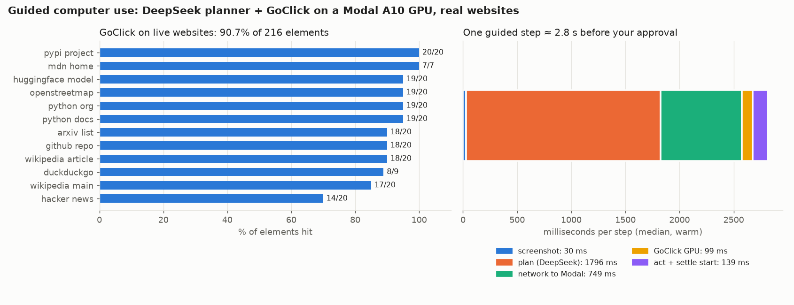

# Guided computer use on real websites — DeepSeek planner + GoClick on a Modal GPU

**Date:** 2026-10-31 · **Folder:** `guided_agent/` (built from scratch; the earlier experiments are in `experiments/`)
**Planner:** DeepSeek `deepseek-flash`, thinking **off**, temperature 0
**Grounder:** GoClick-Base (Florence-2, 0.2 B) on Modal, fp16, `us-east`. Benchmarks ran on A10/A10G; now deployed **T4 first** (§4b)
**Desktop:** Apple container `guided-desktop` (Alpine, Xvfb 1280×800, Firefox) on the real internet
**On a cloud VM:** the same benchmarks run on AWS, and the live-view and browser-backend changes made there, are in [experiments/04_cloud_deployment/REPORT.md](../experiments/04_cloud_deployment/REPORT.md)



---

## Headline

| | Result |
|---|---|
| GoClick on live websites (DOM ground truth) | **196/216 elements hit (90.7 %)** across 12 sites |
| Real-site tasks with known answers, final build | **12/12** (6 tasks × 2) · median **11.2 s** · mean 3.0 steps |
| Same tasks, first build | 11/12 (one 15-step loop on Python docs) |
| One guided step, before your approval (median) | **~2.8 s**: 1.8 s DeepSeek, 0.75 s network to Modal, 0.1 s GPU |
| Cost | DeepSeek **$0.0148** for the 12 final tasks (~$0.0012 per task); GPU billed only while a session is open + 120 s |

This is a **guided** agent, not an autonomous one: every action is shown with its click point on
the live screen and runs only when you approve it. You can move the point by clicking the
screen, reject with a note the planner sees, answer its questions, or stop.

## 1. Architecture

See [ARCHITECTURE.md](ARCHITECTURE.md) for the diagram and file map. In short:

1. **Screenshot** from a control server inside the container (Pillow X11 grab, ~30 ms; the locally deployed
   grounder experiment used SSH + scrot at ~100 ms).
2. **Plan**: DeepSeek sees only the screenshot plus a step history with outcomes, and returns one
   JSON action: `click`, `type` (replace + optional Enter), `key`, `scroll`, `navigate`, `wait`,
   `ask_user`, `done`. It marks risky actions (`"risk":"high"`); passwords and payment details are
   always handed back to you via `ask_user`.
3. **Ground**: for `click`/`type`, GoClick on the Modal GPU returns the point.
4. **You decide** in the web UI (`http://127.0.0.1:8770`).
5. **Act** through xdotool, **wait until the screen stops changing**, then **measure the change**
   globally and in a window around the point. "NO VISIBLE CHANGE" goes back into the history.

### What changed against the locally deployed grounder experiment

(A copy of that experiment and its auto-generated report is in
[`experiments/03_local_grounder/`](../experiments/03_local_grounder/README.md).)

| Locally deployed grounder | This build |
|---|---|
| autonomous, 6-step cap | guided; 25-step cap; every action approved |
| malformed reply costs a step | retried up to 3×, never costs a step (0–1 retries per 12 tasks) |
| no check that an action did anything | screen-change check after every action, fed back to the planner |
| repeated a dead click 6 times | dead click points are remembered; repeats are flagged in the UI and the planner is told to change approach |
| fixed the To field by editing the test page | no page edits possible (real sites); fixed in the agent instead |
| mock page, scored by page state | 12 live sites; scored by DOM ground truth (grounding) and known answers (tasks) |
| SSH per action | one kept-alive HTTP connection to a control server in the container |
| GoClick on local CPU/MPS (Modal "down") | GoClick on a Modal GPU, cold-start overlap, keep-alive while a session is open |

## 2. Grounding on live websites

`bench_grounding.py`: each page is opened in headless Chromium at 1280×800. The DOM supplies every
visible, unobscured interactive element and its box. **GoClick sees only pixels and a description**
such as "the 'Log in' link". Labels shared by more than one element are dropped, since no description
can single them out. Up to 20 per page, one upload per page.

| Element | n | Hit |
|---|---|---|
| buttons | 22 | **100 %** |
| inputs / tabs / dropdown | 4 | 100 % |
| links | 190 | 89.5 % |
| **all** | **216** | **90.7 %** (92.1 % within 10 px) |

| Element size | n | Hit |
|---|---|---|
| < 600 px² (citation marks, user names) | 19 | **68 %** |
| 600–4,000 px² | 155 | 92 % |
| ≥ 4,000 px² | 42 | 98 % |

- **Misses are mostly a different element, not a near miss.** The median miss is 126 px away.
- **Where it misses:**
  - Hacker News (14/20): tiny, repeated metadata links such as user names, "N hours ago" and "N comments".
  - Wikipedia `[5]`/`[6]` citation marks, which are 210 px².
  - Image captions whose link is the image, not the text.
  - Badges and icon links (Trendshift badge, "Launch Interactive Shell").
- **My first pass undercounted it at 88.6 %.** The MDN "CSS"/"JavaScript" text links share their labels
  with the top menu items, and GoClick picked the menu items, which are valid answers. The
  ambiguity filter now compares labels across all element types. Only the rerun's data is kept
  (`benchmark/grounding.json`); the first pass is recorded here only as its score.
- **GPU time is 73–99 ms per target**, depending on whether Modal assigned an A10 or an A10G.

## 3. End-to-end tasks on real sites

`run_tasks.py`: six read-only tasks with answers that can be checked. The "guide" approves every
proposal unchanged, so these numbers show the agent's own judgement with no human corrections.

| Task | Site | v1 | v2 | **v3 (final)** |
|---|---|---|---|---|
| Year the Eiffel Tower was completed | Wikipedia search | 2/2 | 2/2 | **2/2** |
| Author of "On Computable Numbers" | Wikipedia search | 2/2 | 2/2 | **2/2** |
| Python version that added `str.casefold` | docs.python.org search | **1/2** | 2/2 | **2/2** |
| Licence of ultralytics | GitHub | 2/2 | 2/2 | **2/2** |
| First post in Show HN | Hacker News | 2/2 | 2/2 | **2/2** |
| `Array.prototype.at()` negative index | MDN search | 2/2 | 2/2 | **2/2** |
| **Total** | | 11/12 | 12/12 | **12/12** |
| Mean steps / median time | | 3.7 / 12.7 s | 2.8 / 12.1 s | 3.0 / 11.2 s |
| Steps with no visible change | | 13 | 2 | 1 |

**The v1 failure.** The planner described the whole search result,
"str.casefold (Python method, in Built-in Types)". GoClick aimed at the centre of that line (x=553),
which is plain text; the link is only the left part (x≈440). Nothing changed, so the planner reworded
the target 12 times, GoClick returned the same pixel each time, and the run hit the 15-step limit.
This is the same failure the locally deployed grounder experiment hit with the To field: **a grounder points at the centre
of what you describe, which may not be the part that responds to a click.**

Two fixes, in v2:

1. **Prompt rule:** describe only a link's own words.
2. **Dead-spot memory:** points that produced no change are listed in the history with an instruction
   to change approach, and a repeat is flagged in the UI.

In v2 and v3 the same mistake still happens once per run (step 3 clicks the line centre). The agent
now **recovers on the next step**, clicking the link at x=440.

## 4. Latency: where a step goes

| Stage | Median | Note |
|---|---|---|
| screenshot | ~30 ms | control server, Pillow X11 grab |
| plan (DeepSeek) | 1,796 ms | ~1,200 prompt tokens with the image, ~45 output tokens |
| network to Modal | 749 ms | v3 with keep-alive; see below |
| GoClick on GPU | 99 ms | A10G fp16, one target |
| act | 139 ms | click/type via xdotool; then up to 4 s settle |

### Three findings on Modal

**1. Modal was not down. This network breaks Python's IPv6.**
`api.modal.com` resolves to NAT64 IPv6 addresses (`64:ff9b::/96`) that accept no connections. Python's
asyncio tries them first and never falls back; `curl` does fall back, so the API looked "up" while
every `modal` command hung. That is the cause of the "Modal control plane unreachable" result in
the locally deployed grounder experiment's report, not a Modal outage. `ipv4_only.py` forces IPv4 and `modal_cli.py` wraps
the CLI. Deploys take 4 s.

**2. The floor is distance, not upload size.** An empty, rejected request takes ~476 ms from India. A
1280×800 JPEG (100 KB) adds only ~40–80 ms over a 48 KB one. Pinning the worker to Asia
(`region="ap"`) was worse, at 1,001 ms: requests still enter Modal through `us-east` and are then
forwarded, and that worker was a T4 (175 ms GPU). See `results/region_test.json`.

**3. Idle gaps cost ~1.5 s.** After **5 s or more without a request**, the next call takes about
2 s of network time instead of 0.4–0.5 s, even with the GPU container still running. HTTP/1.1 and
HTTP/2 behave the same (`results/keepalive_test.json`). A guided agent always idles while you decide,
so in v2 most steps paid this (median 1.3 s). The session now sends a tiny grounding call every 2.5 s
while it is open; in isolated tests that brings calls back to 0.35–0.65 s. In the task runs the
median fell to **0.75 s**. The first call of each task still often pays the gap left by the previous
task.

**Cold start:** the first call after a scale-down took 12.8–16.3 s (7.6 s of it model load). Opening
the UI or starting a task fires a warm-up call, so the cold start overlaps with you typing the task
and with the first planning call.

## 4b. T4 vs A10G

The A10G was never a deliberate choice. The first deploy asked for an L4, none was free, and the
fallback list `L4 → A10G → T4` always landed on an A10/A10G. Rerunning on a T4 only:

| | A10G (v3) | **T4 (v4)** |
|---|---|---|
| GoClick per target, warm | 73–100 ms | 115–160 ms |
| Cold start (first call) | 12.8–16.3 s (7.6 s model load) | 22.0 s (9.1 s model load) |
| SkyHook 6-target check | 6/6 | 6/6 |
| Real-site tasks | 12/12, median 11.2 s | **12/12, median 9.3 s** |
| Step medians: plan / network / GPU | 1,796 / 749 / 99 ms | 1,455 / 621 / 160 ms |

- **The T4 costs ~60 ms more GPU time per step**, about 2–3 % of a guided step.
- **It was faster end to end here** because DeepSeek and the network happened to be quicker during
  that run. Variance in those two dwarfs the GPU difference.
- **Each GPU type ran in a single run of 12 tasks**, so the comparison isn't controlled.
- **The T4 is roughly half the hourly price** (Modal list price as I recall it; not re-checked). You pay
  for every second the container is up, including the session keep-alive and the 120 s idle window.

**Decision: deploy `T4 → L4 → A10G`.** The fallbacks avoid waiting for capacity. The extra cold-start
time is mostly hidden by the warm-up call the UI fires when the page opens. Data:
`results/grounder_smoke_t4.json`, `results/tasks_v4_t4.json`.

## 5. Bugs found and fixed while building

| Bug | Effect | Fix |
|---|---|---|
| `xdotool mousemove --sync` waits for a motion event; none comes if the pointer is already there | clicks on the same spot as the previous one stalled 5–18 s | plain `mousemove` + 30 ms pause; the affected run was set aside in `results/discarded_mousemove_bug/` |
| Modal returns `303` while a GPU cold-starts | client error on the first call | follow redirects |
| No L4 available ("waiting to be scheduled") | first deploy never served | GPU list `["L4", "A10G", "T4"]`; Modal gave A10/A10G every time |
| Container IP changes on every restart | agent pointed at a dead address | read the IP from `container inspect` |

## 6. Caveats

- **The task benchmark is small**: six read-only tasks, 2 runs each, per build. The answers are facts
  that can be checked; there were no logins, forms, purchases or cookie walls (the Firefox profile
  rejects trackers).
- **The approvals in the benchmark were automatic.** That measures the agent unaided. A real guided
  session is slower (you read each step) but can only be more accurate, since you can correct points.
- **The grounding benchmark** scores against Chromium's layout while the agent drives Firefox. It
  measures GoClick, not the whole loop. It only includes elements whose label is unique on the page,
  which flatters it on pages full of repeated links.
- **Network numbers** are from one home connection in India to Modal `us-east`, on one evening.
- DeepSeek's alias `deepseek-flash` currently maps to V4.1 Flash 1017; the API doesn't confirm the
  exact version. Prices used: $0.30 per 1M input tokens and $1.20 per 1M output tokens, not
  re-checked.
- **Licensing**: GoClick-Base is on Hugging Face; check its licence before any commercial use.

## 7. Run it

```bash
cd guided_agent
container build --tag guided-desktop:2 --file desktop/Dockerfile desktop
container run -d --name guided-desktop -c 2 -m 3G guided-desktop:2
.venv/bin/python modal_cli.py deploy grounder_modal.py      # once; IPv4-safe wrapper
export DEEPSEEK_API_KEY=...                                   # never written to disk
.venv/bin/python webdemo.py                                   # http://127.0.0.1:8770
# benchmarks
.venv/bin/python bench_grounding.py 20
.venv/bin/python run_tasks.py 2
.venv/bin/python render_scorecard.py
```

The grounder token lives in `guided_agent/.grounder_token` (mode 600, git-ignored) and in the Modal
secret `guided-cua-auth`.
